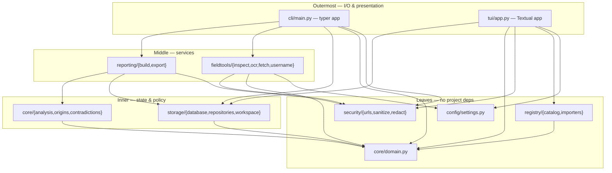

# TRACEFIELD

**TRACEFIELD is the provenance and continuity layer between OSINT collection
and the report.** It is not a collector and not another tool list: you keep
using Sherlock, Maigret, SpiderFoot, ExifTool and the Bellingcat toolkit —
TRACEFIELD stores what they produced as hash-addressed, re-verifiable evidence
under a scoped case, records the chain of actions, refuses to grade truth as a
probability, and exports a bundle whose integrity anyone can re-check with
`sha256sum`. Its catalogue's honesty is that it counts what it has *not*
verified.

> **Status:** alpha (v0.1.0, pre-first-release). Terminal-first CLI + optional
> TUI. Local-first: no telemetry, no chatbot, no cloud dependency. All output
> below is from a **synthetic demonstration case** with fixture data.

## Why

OSINT findings rarely survive the trip from collection to report with intact
provenance. Links rot, screenshots lose their chain of custody, "two sources
said so" often means "one wire story was copied twice", and tool catalogues
pad their counts. TRACEFIELD exists to close that gap with three rules:

1. **Every artifact is content-addressed and re-verifiable** without the tool
   (`sha256sum` agrees with our manifests).
2. **Every conclusion links back to evidence**, and the assessment labels are
   workflow states with published criteria — never probabilities of truth.
3. **Every count is tiered and dated** — indexed ≠ verified ≠ integrated ≠
   healthy.

## What this is not

Not novel, and never claimed as such: content hashing, EXIF/ffprobe metadata
reading, tesseract OCR wrapping, "a big list of OSINT tools", username
enumeration, case folders, content-addressed evidence stores (git and other
CAS designs predate this), SQLite storage, JSON output, secret redaction.
Competitor facts: `docs/strategy/COMPETITOR_MATRIX.md` (dated, sourced).

## Install (development)

```bash
python3 -m venv .venv
.venv/bin/pip install -e '.[dev]'
.venv/bin/tracefield --help
```

Requires Python ≥3.11 (CI tests 3.11–3.13). Optional backends — `exiftool`,
`ffprobe`, `tesseract` — are detected at runtime and reported UNAVAILABLE
honestly if missing.

## Five-minute first case

```bash
tracefield doctor                       # local environment, never network
tracefield case create demo \
  --purpose "synthetic demonstration" --scope "local fixtures only"
tracefield source add https://example.org/article --case demo   # metadata only
tracefield claim add --case demo \
  --text "Example Corp announced a breach affecting 2026-03-01 records"
tracefield evidence attach ./article.html --case demo --json
tracefield relation add --case demo --from <claim_id> --to <evidence_id> \
  --type supports --evidence <evidence_id> \
  --rationale "article text states the breach date"
tracefield relation review <relation_id> --state confirmed
tracefield analyze claim <claim_id> --case demo --json
tracefield report demo --format markdown
tracefield case-export demo --output ./demo-export
tracefield case-verify ./demo-export    # anyone can re-check the bundle
```

Network features are doubly opt-in (`TRACEFIELD_ALLOW_NETWORK=1` **and** an
explicit `--fetch` flag); the SSRF policy is re-validated per request and per
redirect, and connections are pinned to pre-validated addresses.

### Synthetic demonstration transcript

Excerpt from the labelled synthetic fixture case (identical flow exercised by
`tests/e2e/test_demo_case.py`; no real people or incidents):

```
$ tracefield analyze claim claim_5f2a… --case demo --json
{
  "outcome": "CORROBORATED_WITH_LIMITATIONS",
  "supporting_count": 2,
  "contradicting_count": 0,
  "rule_version": "assess-2",
  "caveats": [
    "2 confirmed independent origins with at least one corroboration
     relation. Independence rests on the absence of origin-cluster
     membership; confirm clustering review state before relying on this
     label."
  ]
}
$ tracefield case-verify ./demo-export
manifest OK — N files re-hashed, all intact
```

## Feature matrix (honest status)

| Area | Status | Notes |
|---|---|---|
| Case lifecycle, evidence attach/verify, export + manifest | **implemented** | 0o400 content-addressed copies; redact-then-manifest |
| Claims, relations, analyst review, `analyze claim` | **implemented** | Decision table pinned by tests; `RULE_VERSION` recorded |
| Origin clustering (containment r3) | **implemented** | Ordered k=3/4/5 shingles; advisory `related_text` edges |
| Contradiction candidates (dates/digests/quantities) | **implemented** | Always severity `candidate`; requires review |
| Reports (Markdown/JSON/HTML) with caveats + versions | **implemented** | HTML is self-contained, fully escaped, no external resources |
| `hash` / `inspect [--deep]` / `ocr` | **implemented** | Backends optional; UNAVAILABLE is honest |
| `fetch --fetch` (SSRF-guarded) / `username check` | **implemented** | Opt-in; soft-404 markers; 1 req/s; no bulk mode |
| Tool catalogue + tiered `tools status` | **implemented** | 2,264 inert records; counts never padded |
| TUI | **experimental** | Keyboard workflow tested headless; active-case model + `c` case picker |
| Structured logging (JSONL audit) | **implemented** | `command`/`fail`/`unhandled` events; redacted, capped, `0600` |
| Health-check job for catalogue rows | **planned** | Schema fields exist, no job |
| Perceptual hashing for images | **planned** | |
| Plugin/adapter entry points | **implemented** | Typed `ToolAdapter` boundary in `src/tracefield/adapters.py`; `integration_state=integrated` requires an adapter proven end-to-end; proposal flow in CONTRIBUTING |
| Retention / erasure workflow | **planned** | |

## Evidence flow (how a conclusion traces to bytes)

```
source add ──► Source (locator, captured_at, limitations)
                  │
evidence attach ──► EvidenceItem (sha256, 0o400 copy under <case>/evidence/)
                  │         └──► analysis_event (hash-chained, prev_digest)
claim add ──────► Claim (the proposition under test)
relation add ───► Relation (from/to, type, rationale, evidence_ids)
relation review ┘   └──► analyst marks CONFIRMED / REJECTED
analyze claim ──────► AssessmentVector (outcome + caveats + RULE_VERSION)
report / case-export ─► report.md/json + manifest.json (digests of final bytes)
case-verify ──────────► re-hashes every file against the manifest
```

SHA-256 proves byte-level integrity of the stored object, not truthfulness,
authorship, or authenticity. That sentence is a product guarantee, not a
disclaimer.

## Synthetic demonstration (reproducible)

The full workflow above runs end-to-end on a fully synthetic case — fictional
company, generated fixtures, no network, no real persons — through the real
CLI binary:

- `docs/demo/run_synthetic_demo.sh` — the reproducible script (fresh
  `TRACEFIELD_HOME` each run).
- `docs/demo/DEMO_SESSION.txt` — a recorded terminal session of that script
  (plain text, captured with `script`, ANSI stripped).
- `tests/e2e/test_demo_case.py` — the same workflow as a test with hard
  assertions (clustering merges syndicated copies, contradictions stay
  candidates until reviewed, assessment is byte-reproducible, a tampered
  export fails `case-verify`).

## Catalogue counts (measured, tiered)

```
$ tracefield tools status
catalogue records: 2264
  by integration state:  indexed 2254, verified 10
  by entry type:         website 1904, cli_tool 256, api_service 64,
                         reference 19, dataset 13, library 8
  by license (top):      UNKNOWN 2257, GPL-3.0 4, MIT 3
```

Catalogue records are **inert data, never code**. `verified` is deliberately
small because each verification is a real licence/identity check. Data
provenance and licence rules: `data/catalog/source-manifest.json` and
`docs/strategy/RESEARCH_REGISTER.md`.

## Security & privacy

**Guarantees**

- Case data stays on this machine. No telemetry code exists.
- Network is doubly opt-in; SSRF policy denies loopback/private/link-local/
  multicast/reserved/metadata targets and re-validates every redirect;
  connections are pinned to pre-validated IPs (DNS-rebinding resistant).
- At rest: data dirs `0700`, database `0600`, evidence copies `0400`.
- Untrusted strings (source text, filenames, tool output) are sanitized and
  markup-escaped before terminal rendering; JSON output is escaped.
- Export manifests are built after redaction over the final bytes, so
  redacted exports verify.

**Non-guarantees**

- Hashes prove bytes, not truth. Metadata can be stripped, fabricated, or
  edited; presence proves nothing about authenticity.
- Assessment labels are workflow states with published criteria, not
  probabilities of truth. Origin clusters are hypotheses until
  analyst-confirmed. Contradiction candidates always require review.
- The event hash chain is tamper-*evident* within this store's threat model
  only; a sufficiently privileged operator who rewrites every row can defeat
  it. Not a blockchain.
- OCR output is machine-derived, not verified transcription.
- "A public handle exists" is not identity attribution.
- TRACEFIELD does not grant legal authorization to investigate anyone; the
  operator is responsible for scope, ToS, and law. There is no scope ledger.
- GPS-bearing files are *listed* in `SENSITIVE_METADATA.txt` on export (key
  names, not values); binaries are never silently rewritten — scrubbing before
  distribution is the operator's job.

## Limitations (read this)

- Optional backends (`exiftool`/`ffprobe`/`tesseract`) must be installed by
  you; TRACEFIELD reports them as unavailable rather than faking success.
- Username checks cover a deliberately small curated provider set with
  conservative match rules; Sherlock/Maigret cover 10–1000× more sites.
- The TUI is experimental but functional: it has an active-case model with a
  `c` case picker, runs repo queries via async workers (`run_worker`), and
  supports cooperative `Ctrl+C` cancellation — every feature also has a CLI
  path.
- Catalogue rows are links + project-authored factual summaries. A typed
  adapter contract exists (`src/tracefield/adapters.py`); the counts stay
  tiered and honest — `indexed` 2,254, `verified` 10, and no catalogue row
  claims `integrated` yet. Adapter-integration truth lives in the adapter
  registry: exactly one adapter is `integrated` (`exiftool-meta`, proven
  end-to-end by the test suite, which runs with exiftool installed in CI);
  `ffprobe-streams` and `tesseract-ocr` are `spec-only` (UNAVAILABLE out of
  the box until you install those backends).
- Performance is recorded as a baseline, not a benchmark claim: TUI
  switch+load ~0.9 s at 5,000 rows, `build_report` sub-millisecond on small
  cases (`PHASE_07_REPORT_TESTING.md`).

## Architecture



Layering rule: arrows point toward `core/domain.py`; `core/` is pure (no
storage/network/TUI imports), enforced by review and tests.

## Platform / provider notes

- Linux-first (developed on Parrot Security 7.4); macOS should work but is
  untested; Windows is untested (path and permission semantics differ).
- Username-check providers are a curated allowlist with per-provider soft-404
  markers; 429 → RATE_LIMITED (not retried), 403 → BLOCKED (not circumvented).
- `fetch` requires both `TRACEFIELD_ALLOW_NETWORK=1` and `--fetch`; some
  corporate DNS setups resolve metadata hostnames and will be refused.

## License & attribution

Code: [Apache-2.0](LICENSE). Catalogue data retains per-source attribution —
`jivoi/awesome-osint` (CC BY-SA 4.0), `lockfale/OSINT-Framework` (MIT) —
with project-authored descriptions; see
`data/catalog/source-manifest.json` and `docs/strategy/RESEARCH_REGISTER.md`.
No endorsement by any listed upstream is implied.

## Contributing & security

Contributing: [CONTRIBUTING.md](CONTRIBUTING.md). Vulnerability reports:
[SECURITY.md](SECURITY.md) (private reporting; no fake response SLA).
Conduct: [CODE_OF_CONDUCT.md](CODE_OF_CONDUCT.md). Changelog:
[CHANGELOG.md](CHANGELOG.md). Design decisions and risk register:
`docs/strategy/`. OWASP OOVS v0.1.0 self-assessment:
`docs/oovs/OOVS_MAPPING.md` (maintainer self-assessment only — no
certification or endorsement claimed).
