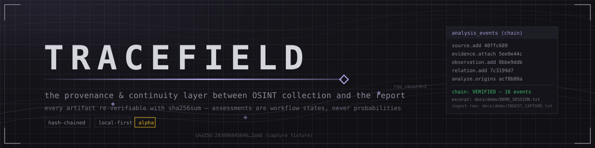
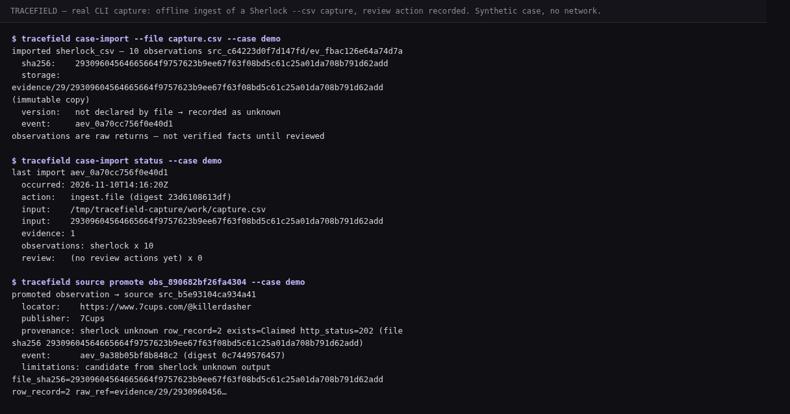
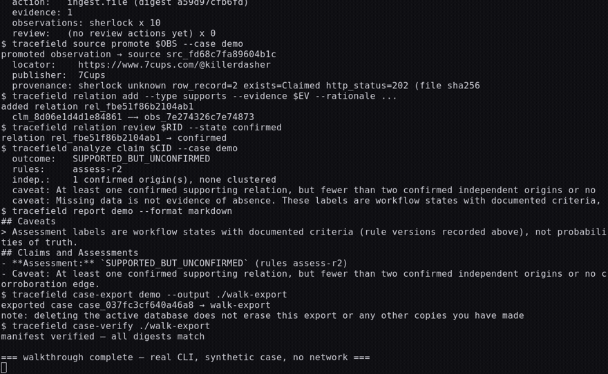
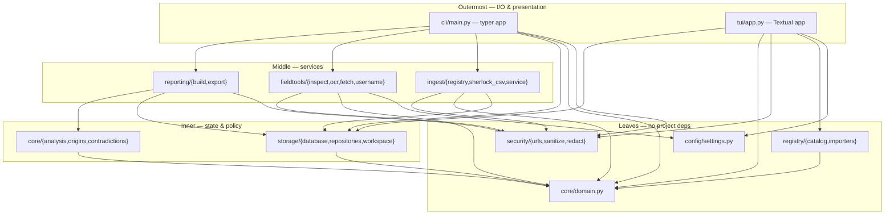

# TRACEFIELD

<p align="center">
  
</p>

<p align="center">
  <a href="https://github.com/killerdasher/TRACEFIELD/actions/workflows/ci.yml"></a>
</p>

**TRACEFIELD is the provenance and continuity layer between OSINT collection
and the report.** It is not a collector and not another tool list: you keep
using Sherlock, Maigret, SpiderFoot, ExifTool and the Bellingcat toolkit —
TRACEFIELD stores what they produced as hash-addressed, re-verifiable evidence
under a scoped case, records the chain of actions, refuses to grade truth as a
probability, and exports a bundle whose integrity anyone can re-check with
`sha256sum`. Its catalogue's honesty is that it counts what it has *not*
verified.

> **Status:** alpha (v0.1.0 released; the 0.2 offline-ingest slice is on
> `main`). Terminal-first CLI + optional TUI. Local-first: no telemetry, no
> chatbot, no cloud dependency. All demonstration output below is from
> **synthetic fixture cases** — no real persons, no live targets.
>
> CI note (honest badge): the py3.11–3.13 test jobs, mypy `--strict` and
> pip-audit pass on the latest commit. The lint job's earlier red state was
> a version drift: the project allowed any ruff `>=0.16,<1`, and 0.17.x
> format rules changed for 13 files while CI resolved a newer ruff than
> dev machines had. Fixed: the tree now pins **`ruff==0.17.1`** exactly in
> `pyproject.toml` and adopts that formatter's output (`ruff format src
> tests` applied, verified whitespace-only). Pushing this tree greens the
> lint job; the exact pin keeps dev and CI byte-identical.

## What it does, in one pass

The image below is a **real capture** of the 0.2 offline ingest: a copy of
the version-pinned Sherlock fixture (byte-identical, sha256-verified) imported
into a fresh synthetic case, then one observation promoted with full
provenance. The box is a faithful render of actual CLI output — the raw text
capture lives in [`docs/demo/INGEST_CAPTURE.txt`](docs/demo/INGEST_CAPTURE.txt).

<p align="center">
  
</p>

Concretely:

1. **Every artifact is content-addressed and re-verifiable** without the tool
   (`sha256sum` agrees with our manifests).
2. **Every conclusion links back to evidence**, and the assessment labels are
   workflow states with published criteria — never probabilities of truth.
3. **Every count is tiered and dated** — indexed ≠ verified ≠ integrated ≠
   healthy.

## Why

OSINT findings rarely survive the trip from collection to report with intact
provenance. Links rot, screenshots lose their chain of custody, "two sources
said so" often means "one wire story was copied twice", and tool catalogues
pad their counts. TRACEFIELD exists to close that gap.

Not novel, and never claimed as such: content hashing, EXIF/ffprobe metadata
reading, tesseract OCR wrapping, "a big list of OSINT tools", username
enumeration, case folders, content-addressed evidence stores (git and other
CAS designs predate this), SQLite storage, JSON output, secret redaction.
Competitor facts: `docs/strategy/COMPETITOR_MATRIX.md` (dated, sourced).

## Try it — five minutes, no network

```bash
python3 -m venv .venv
.venv/bin/pip install -e '.[dev]'
.venv/bin/tracefield --help
```

Requires Python ≥3.11 (CI tests 3.11–3.13). Optional backends — `exiftool`,
`ffprobe`, `tesseract` — are detected at runtime and reported UNAVAILABLE
honestly if missing.

```bash
tracefield doctor                       # local environment, never network
tracefield case create demo \
  --purpose "synthetic demonstration" --scope "local fixtures only"
tracefield source add https://example.org/article --case demo   # metadata only
tracefield claim add --case demo \
  --text "Example Corp announced a breach affecting 2026-03-01 records"
tracefield evidence attach ./article.html --case demo --json
tracefield relation add --case demo --from <claim_id> --to <evidence_id> \
  --type supports --evidence <evidence_id> \
  --rationale "article text states the breach date"
tracefield relation review <relation_id> --state confirmed
tracefield analyze claim <claim_id> --case demo --json
tracefield report demo --format markdown
tracefield case-export demo --output ./demo-export
tracefield case-verify ./demo-export    # anyone can re-check the bundle
```

### Ingest a Sherlock capture (offline)

Import an existing Sherlock `--csv` result into a case — file only, no
network, rows map verbatim to observations:

```bash
tracefield case-import --file capture.csv --case demo
tracefield case-import status --case demo       # last import + live counts
tracefield source promote <obs_id> --case demo  # records provenance, never fetches
tracefield source dismiss <obs_id> --reason "site returns 403 for everyone"
tracefield source defer <obs_id>                # park it, no verdict yet
```

Refusals are typed and fail closed: oversized files, unrecognized headers,
unsupported declared versions, and zero-row files are rejected with the
observed facts named, before anything is written. Review actions are
hash-chained; a dismissed observation stays dismissed until a fresh recorded
decision exists.

Network features are opt-in and authorized: `TRACEFIELD_ALLOW_NETWORK=1`
**and** an explicit `--fetch` flag, **plus** a recorded scope grant for the
case (`tracefield case authorize <case> --scope "<text>" --authorized-by
"<name>"` — a hash-chained ledger; `case scope` shows it). The SSRF policy is
re-validated per request and per redirect, and connections are pinned to
pre-validated addresses.

## The evidence lifecycle

Everything above, as one picture. Dashed outlines mark advisory or gated
surfaces; solid cards are the enforced path. Every step emits an event in the
hash chain at the bottom.

<p align="center">
  
</p>

SHA-256 proves byte-level integrity of the stored object, not truthfulness,
authorship, or authenticity. That sentence is a product guarantee, not a
disclaimer. The diagram's editable Mermaid source:
`docs/architecture/evidence-lifecycle.mmd`.

## One real assessment, verbatim

From a synthetic run of the real CLI — the same 0.2 ingest workflow shown in
the terminal capture above (no network, fixture data, no real persons; the
committed end-to-end demo is `docs/demo/DEMO_SESSION.txt`):

```
$ tracefield analyze claim clm_4ddf… --case demo --json
{
  "claim_id": "clm_4ddf62b1c61a416b",
  "provenance_completeness": "complete",
  "evidence_directness": "linked",
  "independence": "1 confirmed origin(s), none clustered",
  "source_transparency": "partial",
  "temporal_fit": "unknown",
  "supporting_count": 1,
  "contradicting_count": 0,
  "missing_information": "see caveats",
  "reproducibility": "deterministic rules assess-r2",
  "outcome": "SUPPORTED_BUT_UNCONFIRMED",
  "caveats": [
    "At least one confirmed supporting relation, but fewer than two confirmed independent origins or no corroboration edge.",
    "Missing data is not evidence of absence. These labels are workflow states with documented criteria, not probabilities of truth."
  ],
  "rule_version": "assess-r2"
}
```

Every field above is reproduced as the CLI printed it, including the
single-line caveat strings; only the wall-clock `computed_at` field is
omitted, for legibility.

## Feature matrix (honest status)

| Area | Status | Notes |
|---|---|---|
| Case lifecycle, evidence attach/verify, export + manifest | **implemented** | 0o400 content-addressed copies; redact-then-manifest |
| Claims, relations, analyst review, `analyze claim` | **implemented** | Decision table pinned by tests; `RULE_VERSION` recorded |
| Origin clustering (containment r3) | **implemented** | Ordered k=3/4/5 shingles; advisory `related_text` edges |
| Contradiction candidates (dates/digests/quantities) | **implemented** | Always severity `candidate`; requires review |
| Reports (Markdown/JSON/HTML) with caveats + versions | **implemented** | HTML is self-contained, fully escaped, no external resources; reports carry a durable identity (report_id/revision/supersedes) and corrections travel with the lineage; `case-export --recipient` records shipments (dissemination register); the operating analyst's author identity is carried when configured (per-operator config file or `TRACEFIELD_REPORT_AUTHOR`) — unset installs honestly print `author not set` |
| Report corrections & history | **implemented** | `report-correct` appends corrections (never silent rewrites); `report-history` lists revisions, corrections, recorded shipments; recipients of prior revisions are notified by the operator — the register makes it traceable, nothing is automated |
| Scope authorization ledger | **implemented** | `case authorize/case scope`; `source add --fetch` requires an active recorded grant; records authority, does not grant it |
| `hash` / `inspect [--deep]` / `ocr` | **implemented** | Backends optional; UNAVAILABLE is honest |
| `fetch --fetch` (SSRF-guarded) / `username check` | **implemented** | Fetch: opt-in + recorded scope grant; username checks: env-gated, soft-404 markers, 1 req/s, no bulk mode |
| Offline ingest (Sherlock `--csv`) | **implemented (0.2)** | `case-import --file` + `case-import status` + `source promote/dismiss/defer`; format/version gate, fail-closed refusals, `raw_ref` into the immutable 0o400 copy, hash-chained review events, zero egress; version-pinned fixture (`sherlock_v0.16.2_…2026-11-07.csv`) + schema doc + rotation policy |
| Tool catalogue + tiered `tools status` | **implemented** | 2,264 inert records; counts never padded |
| TUI | **experimental** | Keyboard workflow tested headless; active-case model + `c` case picker; ingest triage overlay (`t`) and cancellable import op (`i`) |
| Structured logging (JSONL audit) | **implemented** | `command`/`fail`/`unhandled` events; redacted, capped, `0600` |
| Health-check job for catalogue rows | **not built, by decision** | `catalog stale` lists freshness (overdue/unparseable dates), explicitly not a health verdict; upstream verification is operator-manual |
| Perceptual hashing for images | **planned** | |
| Plugin/adapter entry points | **implemented** | Typed `ToolAdapter` boundary in `src/tracefield/adapters.py`; `integration_state=integrated` requires an adapter proven end-to-end; proposal flow in CONTRIBUTING |
| Retention / erasure workflow | **planned** | |

## Reproducible synthetic demonstration

The full workflow above runs end-to-end on a fully synthetic case through the
real CLI binary:

- `docs/demo/run_synthetic_demo.sh` — the reproducible script (fresh
  `TRACEFIELD_HOME` each run).
- `docs/demo/DEMO_SESSION.txt` — a recorded terminal session of that script
  (plain text, captured with `script`, ANSI stripped; last refreshed
  2026-11-10 against the current build).
- `tests/e2e/test_demo_case.py` — the same workflow as a test with hard
  assertions (clustering merges syndicated copies, contradictions stay
  candidates until reviewed, assessment analysis fields are reproducible, a
  tampered export fails `case-verify`).
- One loop of the recorded walkthrough (real terminal, real CLI, pacing
  added; provenance in `docs/demo/README.md`):

<p align="center">
  
</p>

- `docs/demo/SAMPLE_REPORT.md` — the verbatim Markdown report from that
  session. `docs/demo/USABILITY_PROTOCOL.md` — a three-tester first-run
  protocol (not yet executed; no usability results exist).

## Catalogue counts (measured, tiered)

```
$ tracefield tools status
catalogue records: 2264
  by integration state:  indexed 2254, verified 10
  by entry type:         website 1904, cli_tool 256, api_service 64,
                         reference 19, dataset 13, library 8
  by license (top):      UNKNOWN 2257, GPL-3.0 4, MIT 3
```

Catalogue records are **inert data, never code**. `verified` is deliberately
small because each verification is a real licence/identity check. Data
provenance and licence rules: `data/catalog/source-manifest.json` and
`docs/strategy/RESEARCH_REGISTER.md`.

## Security & privacy

**Guarantees**

- Case data stays on this machine. No telemetry code exists.
- Network is doubly opt-in; SSRF policy denies loopback/private/link-local/
  multicast/reserved/metadata targets and re-validates every redirect;
  connections are pinned to pre-validated IPs (DNS-rebinding resistant).
- At rest: data dirs `0700`, database `0600`, evidence copies `0400`.
- Untrusted strings (source text, filenames, tool output) are sanitized and
  markup-escaped before terminal rendering; JSON output is escaped.
- Export manifests are built after redaction over the final bytes, so
  redacted exports verify.

**Non-guarantees**

- Hashes prove bytes, not truth. Metadata can be stripped, fabricated, or
  edited; presence proves nothing about authenticity.
- Assessment labels are workflow states with published criteria, not
  probabilities of truth. Origin clusters are hypotheses until
  analyst-confirmed. Contradiction candidates always require review.
- The event hash chain is tamper-*evident* within this store's threat model
  only; a sufficiently privileged operator who rewrites every row can defeat
  it. Not a blockchain.
- OCR output is machine-derived, not verified transcription.
- "A public handle exists" is not identity attribution.
- TRACEFIELD does not grant legal authorization to investigate anyone; the
  operator is responsible for scope, ToS, and law. The scope ledger records
  decisions and gates fetches — it makes no operation lawful and cannot
  verify any authority.
- GPS-bearing files are *listed* in `SENSITIVE_METADATA.txt` on export (key
  names, not values); binaries are never silently rewritten — scrubbing before
  distribution is the operator's job.

## Limitations (read this)

- Optional backends (`exiftool`/`ffprobe`/`tesseract`) must be installed by
  you; TRACEFIELD reports them as unavailable rather than faking success.
- Username checks cover a deliberately small curated provider set with
  conservative match rules; Sherlock/Maigret cover 10–1000× more sites.
- The TUI is experimental but functional: it has an active-case model with a
  `c` case picker, runs repo queries via async workers (`run_worker`), and
  supports cooperative `Ctrl+C` cancellation — every feature also has a CLI
  path.
- Catalogue rows are links + project-authored factual summaries. A typed
  adapter contract exists (`src/tracefield/adapters.py`); the counts stay
  tiered and honest — `indexed` 2,254, `verified` 10, and no catalogue row
  claims `integrated` yet. Adapter-integration truth lives in the adapter
  registry: exactly one adapter is `integrated` (`exiftool-meta`, proven
  end-to-end by the test suite, which runs with exiftool installed in CI);
  `ffprobe-streams` and `tesseract-ocr` are `spec-only` (UNAVAILABLE out of
  the box until you install those backends).
- Performance is recorded as a baseline, not a benchmark claim: TUI
  switch+load ~0.9 s at 5,000 rows, `build_report` sub-millisecond on small
  cases (`PHASE_07_REPORT_TESTING.md`).

## Architecture



Layering rule: arrows point toward `core/domain.py`; `core/` is pure (no
storage/network/TUI imports), enforced by review and tests. The arrow set is
directional summary, not import-exact — e.g. `reporting/export` actually
imports `core/{provenance,domain}`, and ingest sanitization runs CLI-side.
The `ingest` package is deliberately offline: it imports no network-capable
module (R-SEC-6, pinned by a test that trips on any socket use).

## Documentation map

| Start from | What it is |
|---|---|
| [`CONTRIBUTING.md`](CONTRIBUTING.md) | Setup, the gates every PR passes, catalogue/adapter rules |
| [`docs/demo/run_synthetic_demo.sh`](docs/demo/run_synthetic_demo.sh) | Reproducible synthetic end-to-end demonstration |
| [`docs/ingest/SHERLOCK_CSV_SCHEMA.md`](docs/ingest/SHERLOCK_CSV_SCHEMA.md) | Ingest fixture schema, provenance and rotation policy |
| [`docs/architecture/evidence-lifecycle.mmd`](docs/architecture/evidence-lifecycle.mmd) | Editable source of the lifecycle diagram above |
| [`docs/strategy/IMPLEMENTATION_STATUS.md`](docs/strategy/IMPLEMENTATION_STATUS.md) | Per-layer implementation status, dated |
| [`docs/strategy/DECISIONS.md`](docs/strategy/DECISIONS.md) | Design decisions, newest last (D29/D30 among them) |
| [`docs/strategy/RISK_REGISTER.md`](docs/strategy/RISK_REGISTER.md) | Adversarial review findings and residual risks |
| `docs/strategy/*` | Working product-direction documents — honest but *internal*; the README's claims are what's supported |
| [`docs/oovs/OOVS_MAPPING.md`](docs/oovs/OOVS_MAPPING.md) | OWASP OOVS self-mapping (maintainer self-assessment only) |

## Platform / provider notes

- Linux-first (developed on Parrot Security 7.4); macOS should work but is
  untested; Windows is untested (path and permission semantics differ).
- Username-check providers are a curated allowlist with per-provider soft-404
  markers; 429 → RATE_LIMITED (not retried), 403 → BLOCKED (not circumvented).
- `fetch` requires both `TRACEFIELD_ALLOW_NETWORK=1` and `--fetch`; some
  corporate DNS setups resolve metadata hostnames and will be refused.

## License & attribution

Code: [Apache-2.0](LICENSE). Catalogue data retains per-source attribution —
`jivoi/awesome-osint` (CC BY-SA 4.0), `lockfale/OSINT-Framework` (MIT) —
with project-authored descriptions; see
`data/catalog/source-manifest.json` and
`docs/strategy/RESEARCH_REGISTER.md`. No endorsement by any listed upstream
is implied.

## Contributing & security

Contributing: [CONTRIBUTING.md](CONTRIBUTING.md) — synthetic fixtures only,
never commit real investigation data. Vulnerability reports:
[SECURITY.md](SECURITY.md) (private reporting; no fake response SLA).
Conduct: [CODE_OF_CONDUCT.md](CODE_OF_CONDUCT.md). Changelog:
[CHANGELOG.md](CHANGELOG.md).
